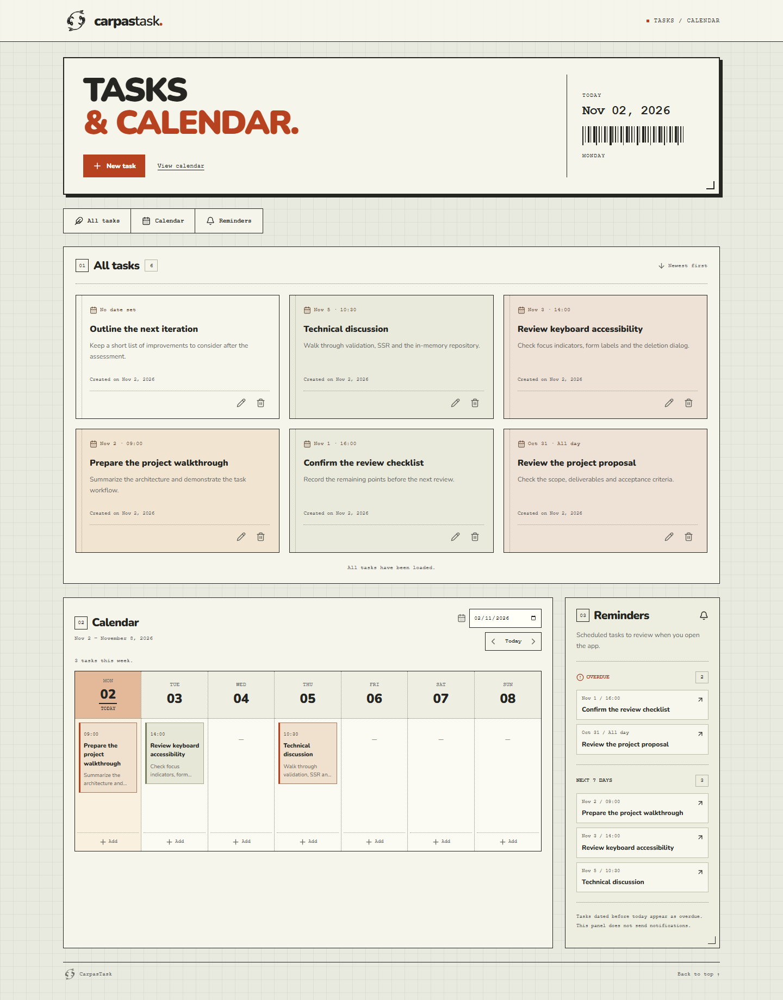
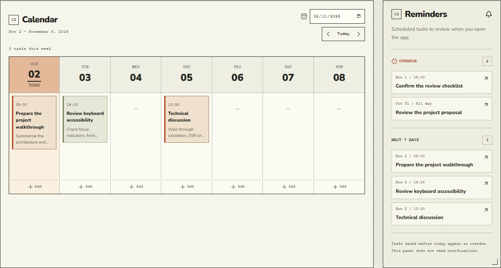
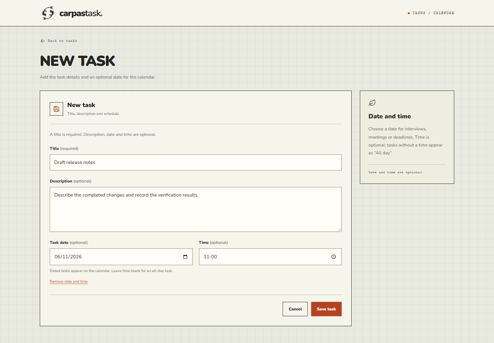
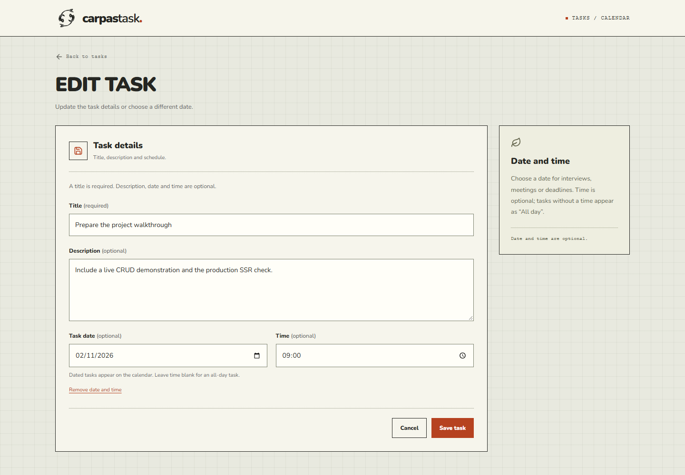
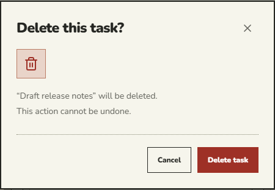
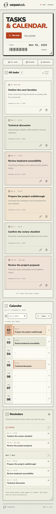
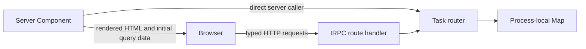

# CarpasTask

A task manager built for the **Artefact Software Engineer — Brasil** practical assessment. Create, view, edit and delete tasks, with the initial list rendered on the server and the backend stored entirely in memory.

The assessment asks for a small, functional application. This implementation keeps the required CRUD flow at the center, adds the two requested bonuses—incremental loading and documentation—and includes optional scheduling and on-page reminders. It uses **Next.js 15**, React and tRPC, with no database, authentication or external backend.

## Demo

The screenshot below shows the actual production application with **six fictitious tasks**: two overdue tasks, three upcoming tasks and one task without a date. Task cards appear first; the weekly calendar and reminder panel appear below them.



All task titles, descriptions and appointments in these images are demonstration data. A normal application start is empty. The demo does not introduce persistent storage or populate another running server.

### Calendar and reminders

Dated tasks appear on their scheduled day. A time is optional; without one, the task appears as **All day**. The reminder panel shows overdue tasks and the next seven days, with totals calculated from the entire repository, independently of the loaded task cards.



### Create, edit and delete

Use **New task** to open the creation page. Only the title is required. After saving, the application returns to the list with success feedback and updates the calendar and reminders.



<details>
<summary>Editing an existing task</summary>

The edit page supports direct navigation and refresh. Updating a task preserves its ID and creation timestamp. Clearing a date also clears its optional time.



</details>

<details>
<summary>Deletion confirmation</summary>

Deletion is available directly from the task list. The task is removed only after the backend confirms success; canceling leaves it unchanged.



</details>

<details>
<summary>Mobile layout</summary>

Cards stack vertically, the calendar becomes a list of days, and actions remain accessible without horizontal page overflow.



</details>

## Run locally

**Prerequisites:** Node.js 22 or newer and npm. Run the application as one local Node.js process.

From the repository root:

```sh
npm ci
npm run dev
```

Open [http://127.0.0.1:3000](http://127.0.0.1:3000). No database, account, environment file or API key is needed. The server binds to loopback by default. Stop it with `Ctrl+C`.

For production mode:

```sh
npm run build
npm run start
```

**Tasks disappear when the server process stops or restarts.** This is intentional: the assessment requires server-side in-memory storage. Development tools may restart the server, so development data should also be treated as temporary.

`npm ci` reproduces the committed dependency lockfile. `npm install` can also install the project. The application remains on Next.js **15.5.28**; it has not been upgraded to Next.js 16.

## Assessment requirements

| Requirement from the practical case                       | Implementation                                                              | Evidence                                                                     |
| --------------------------------------------------------- | --------------------------------------------------------------------------- | ---------------------------------------------------------------------------- |
| Next.js v15                                               | Next.js 15 App Router                                                       | Installed version, strict type checks and production build                   |
| Backend exposed through tRPC                              | Typed task router and HTTP adapter at `/api/trpc/[trpc]`                    | Router tests and production browser CRUD                                     |
| Tasks maintained in server memory                         | Process-wide repository backed by a `Map`                                   | HTTP mutations and a separate server-rendered page request see the same task |
| `id`, `titulo`, `descricao`, `dataCriacao`                | Original Portuguese field names preserved in contracts                      | Validation and repository tests                                              |
| Create, list, update and delete                           | Four tRPC CRUD procedures                                                   | Backend and browser tests                                                    |
| Required title and meaningful errors                      | Shared Zod schemas, `BAD_REQUEST` and `NOT_FOUND`                           | Empty/whitespace titles, invalid IDs and missing records tested              |
| SSR preloads the task list                                | Dynamic Server Component with a direct server-side tRPC caller              | HTML heading assertion and JavaScript-disabled browser                       |
| Delete directly from the list with feedback               | Card action, confirmation dialog and mutation feedback                      | Confirm, cancel and deletion tested                                          |
| Creation/update page with functional components and hooks | Dedicated routes and a reusable stateful form                               | Direct URL, refresh, validation, save and cancel tested                      |
| Loading, success and failure feedback                     | Pending controls, status/alert regions, retry and preserved draft           | Component tests and simulated network failure                                |
| Bonus: infinite scroll                                    | Stable cursor pagination and IntersectionObserver                           | More than two pages loaded without duplicate task IDs                        |
| Bonus: comments and README                                | Comments on non-obvious decisions and this guide                            | Setup, operation, architecture and verification documented                   |
| No sensitive information in a public repository           | Fictitious fixtures/captures, no required secrets, appropriate `.gitignore` | Source review and credential-pattern scan                                    |

The written-case instructions require English responses. This README, the interface, validation messages and demo content are in English. The original data-field names remain Portuguese because the technical case explicitly specifies them.

The practical case permits **at least** the four required fields. `dataAgendada` and `horario` are optional additions; a task without a date remains valid. The calendar and reminders use the same task collection and do not replace any required functionality.

This repository covers the practical application. The separate theoretical answers and PDF submission are outside this README's scope. A public GitHub repository link is the required delivery format for the application; no deployment is necessary.

## Features and usage

- **All tasks:** newest-first cards showing title, optional description, creation date and optional scheduled date/time. Edit and delete actions remain on each card.
- **Create/edit:** title validation, optional details and schedule, disabled controls while saving, and preserved input if a request fails.
- **Delete:** accessible confirmation, a cancel action and feedback after server confirmation.
- **Calendar:** Monday-first weekly view, previous/next week, **Today**, a date picker and a shortcut to add a task on a chosen day.
- **Reminders:** tasks dated before today appear under **Overdue**; today and the following six days appear under **Next 7 days**. Each group shows its total and up to three preview links.
- **Incremental loading:** ten tasks initially, automatic loading near the list end, and a keyboard-accessible **Load more** button.
- **Empty/error states:** clear messages, retry actions and a dedicated task-not-found page.

Reminders are an **on-page summary**, not browser, email or push notifications. There is no completion-status field: the panel classifies tasks by date and explains that rule. It does not infer whether a task was completed outside the application.

## Routes

| Page                            | Purpose                                                                  |
| ------------------------------- | ------------------------------------------------------------------------ |
| `/`                             | Server-rendered task list, calendar, reminders and deletion confirmation |
| `/tarefas/nova`                 | Create a task                                                            |
| `/tarefas/nova?data=2026-11-05` | Create a task with a date prefilled from the calendar                    |
| `/tarefas/[id]/editar`          | Edit an existing task, with server-side lookup and a not-found state     |

Route segments remain Portuguese, alongside the required contract names; visible UI text is English.

## Technology and responsibilities

| Technology                     | Responsibility                                                |
| ------------------------------ | ------------------------------------------------------------- |
| Next.js 15 / React 19          | App Router pages, server rendering and interactive components |
| TypeScript, strict mode        | Static checks and shared inferred API types                   |
| tRPC 11                        | Typed frontend/backend communication and server-side caller   |
| Zod 4                          | Server input validation and immediate form feedback           |
| TanStack Query 5               | Query cache, mutations, invalidation and infinite queries     |
| Tailwind CSS 3 / CSS           | Styling foundations and custom responsive layout              |
| Lucide React                   | Local SVG interface icons                                     |
| Self-hosted Nunito             | Typography without runtime Google Fonts requests              |
| Vitest / React Testing Library | Repository, router, date-utility and component tests          |
| Playwright                     | Production browser tests and real-interface screenshots       |
| ESLint                         | Code-quality and Next.js checks                               |

Next.js, React and tRPC are specified by the case. The other libraries support validation, type safety, testing and interface implementation. No Redux, additional global state library, ORM, database or authentication provider is introduced.

## Architecture



The repository owns collection operations. The tRPC router validates inputs and converts missing records into meaningful errors. React components own interaction state; TanStack Query manages cached server data. A separate service layer would add indirection without additional business rules for this case.

```text
src/
  app/
    api/trpc/[trpc]/route.ts    HTTP adapter for tRPC
    page.tsx                   Dynamic SSR entry point
    tarefas/nova/              Creation page
    tarefas/[id]/editar/       Server-loaded edit page
    error.tsx                  Retryable route error state
    not-found.tsx              Missing task/page state
  components/
    task-workspace.tsx         Cards, navigation, feedback and deletion
    task-form.tsx              Fields, validation and submission state
    task-editor.tsx            Create/update mutations and navigation
    task-agenda.tsx            Weekly calendar
    task-reminders.tsx         Overdue/upcoming summary
    dialog.tsx                 Native modal with focus restoration
    logo.tsx                   Local two-koi SVG mark
  lib/
    task.ts                    Shared contracts and Zod schemas
    calendar.ts                Civil-date and week utilities
    trpc.tsx                   Client/query providers
    ui-error.ts                User-facing error messages
  server/
    api/router.ts              Task procedures and context
    repositories/tasks.ts      Controlled in-memory repository
scripts/
  e2e.mjs                     Production browser-test server lifecycle
  capture-demo.mjs             Isolated demo capture and CRUD walkthrough
tests/
  router.test.ts              Router/repository integration tests
  components.test.tsx         Form behavior tests
  calendar.test.ts            Date-boundary tests
  e2e/tasks.spec.ts            Production browser scenarios
docs/
  demo/                       Six-task demonstration captures
  verification.md             Executed results and limitations
```

### Server rendering and hydration

`src/app/page.tsx` uses the Node.js runtime and `dynamic = "force-dynamic"`. It invokes the tRPC caller directly to load the first task page, the current week and the reminder summary in parallel. The server does not make an HTTP request to itself.

The server renders the task markup and passes the fetched values into query `initialData`. Client interaction then continues through the typed tRPC HTTP client. Query clients are created per provider, rather than shared between visitors. A 30-second stale window avoids an unnecessary request immediately after hydration.

There is no automatic root `loading.tsx` boundary. These small in-memory reads finish before the page is returned, keeping initial content visible even when JavaScript is disabled instead of requiring a script to reveal a streamed fragment. Interactive forms and queries still expose loading feedback.

The SSR browser test creates a task through HTTP tRPC, requests the page, checks for a real task heading in the HTML, and visits the list, calendar/reminders and edit page with JavaScript disabled. This verifies rendered content and shared storage together; using the App Router alone is not treated as proof of SSR.

### Shared memory and lifecycle

`TaskRepository` encapsulates a `Map`. The exported singleton is anchored on `globalThis` so independently bundled route-handler and Server Component module graphs use the same repository inside one Node.js process. Backend modules use `server-only` guards, and repository methods return copies rather than exposing mutable stored objects.

- Data exists only while that process stays alive.
- Restarting loses all tasks; no files, browser localStorage or database persist them.
- Different Node.js processes, containers, clusters or serverless instances do not share tasks.
- The supported assessment environment is a single local Node.js process.

The architecture deliberately does not add persistence or change storage to enable hosting. It follows the case's in-memory requirement.

## Task model and validation

```ts
type Task = {
  id: string; // Server-generated UUID
  titulo: string; // Required, trimmed, 1–120 characters
  descricao?: string; // Trimmed, up to 2,000 characters
  dataCriacao: string; // Server-generated ISO UTC timestamp
  dataAgendada?: string; // Optional civil date: YYYY-MM-DD
  horario?: string; // Optional 24-hour time: HH:mm
};
```

Zod is authoritative on the server and reused for form feedback. Empty or whitespace-only titles, invalid UUIDs, overlong descriptions, impossible calendar dates and invalid times are rejected. Blank descriptions/dates/times normalize to `undefined`.

Updates replace editable fields while preserving `id` and `dataCriacao`. Optional fields are assigned explicitly on update, so clearing a description or schedule works even when JSON serialization omits undefined keys.

Scheduled dates are civil dates between 1900 and 9998. A time requires a date. Clearing a date in the form clears its time; leaving the time blank makes the task all-day. Scheduled values do not undergo UTC conversion. Creation timestamps are separately displayed in UTC, and the server computes the current day in `America/Fortaleza` and passes it to the client to prevent hydration disagreements.

## tRPC procedures

The HTTP adapter is `/api/trpc/[trpc]`. Frontend reads and mutations use tRPC; SSR uses the same router through its direct caller.

`EditableFields` below means `{ titulo, descricao?, dataAgendada?, horario? }`.

| Procedure        | Input                       | Result                                                     |
| ---------------- | --------------------------- | ---------------------------------------------------------- |
| `task.create`    | `EditableFields`            | Created task with server-generated metadata                |
| `task.list`      | `{ limit?, cursor? }`       | `{ items, nextCursor }`                                    |
| `task.get`       | `{ id }`                    | A task for the edit page                                   |
| `task.update`    | `{ id, ...EditableFields }` | Updated task; original ID/date preserved                   |
| `task.delete`    | `{ id }`                    | `{ success: true }` after deletion                         |
| `task.agenda`    | `{ inicio, fim }`           | All scheduled tasks within the short date range            |
| `task.reminders` | `{ hoje }`                  | Overdue/upcoming totals and up to three previews per group |

List limits are integers from 1 to 50, defaulting to 10. A cursor carries both `dataCriacao` and `id`. Calendar ranges must be valid, ordered civil dates with a difference of at most 31 days.

Invalid input produces `BAD_REQUEST`. Missing tasks produce `NOT_FOUND`. Unexpected internal failures use a generic message and omit response stack traces. The interface handles API failures without discarding the user's draft.

## Pagination and synchronization

The list sorts by descending creation timestamp, with descending ID as a stable tie-breaker. Cursor comparisons use both fields instead of page offsets or a lookup of the cursor's record. Pagination therefore continues when that record is deleted. Tests include identical timestamps, a deleted cursor boundary and insertion between page loads.

An IntersectionObserver preloads within 160px of the list end. Requests are blocked while a fetch is already running, rendered tasks are deduplicated by ID, and **Load more** remains available as an accessible fallback. The final page shows an end-of-list message.

The calendar and reminders query the complete repository for their date criteria. They do not derive their contents from only the ten initially loaded task cards. Create, update and delete invalidate all three query groups; the list rebuilds cursor boundaries and scheduled views reflect moved or cleared dates. Deletion waits for backend confirmation rather than permanently hiding a task optimistically.

## Testing and verification

```sh
npm run typecheck
npm run lint
npm run test
npx playwright install chromium
npm run build
npm run test:e2e
```

Leave **port 3000 free** before running the browser suite. Stop the development/preview server first. The test runner owns a fresh production server built with `dev: false`, starts Playwright, and shuts the server down when the suite ends. Browser tests run serially and clear their own test repository before each scenario. There is no public reset endpoint.

Backend tests use separate repository instances so they do not depend on execution order or the global application state. Fixtures are fictitious. Tests cover validation, CRUD, missing tasks, immutable creation metadata, deterministic sorting, cursor consistency, date boundaries, reminders beyond one page, form pending/error/cancel behavior and failed-request recovery.

Browser scenarios cover the full CRUD flow, deletion focus restoration, direct edit URLs, SSR without JavaScript, automatic/fallback pagination, mobile/tablet/desktop overflow, local font loading, scheduling, date removal and reminder synchronization.

Executed results, audit scope and known limitations are recorded in [the verification report](docs/verification.md). The report distinguishes checks that actually ran from implementation claims; screenshots are not used as substitutes for automated assertions.

Latest verified results, November 2, 2026:

| Check                                 | Result                                              |
| ------------------------------------- | --------------------------------------------------- |
| Strict TypeScript / ESLint            | Passed                                              |
| Unit, integration and component tests | 21 passed                                           |
| Production build                      | Passed on Next.js 15.5.28                           |
| Production browser scenarios          | 8 passed on Chromium                                |
| Isolated demo capture                 | Passed; six task fixtures and browser CRUD verified |

### Reproduce the demo screenshots

```sh
npx playwright install chromium
npm run build
npm run demo:screenshots
```

The capture script uses a separate production process on **port 3100**. It creates the six fictitious tasks through tRPC, verifies the reminder counts, captures desktop/mobile views, and walks through create/edit/delete in the browser. Images are written to `docs/demo/`.

It does not connect to or reset a development server on port 3000. Dates are relative to the capture day, so later captures remain meaningful. The temporary demo repository disappears when the capture process exits. This script is documentation tooling, not a seed mechanism or persistent application storage.

## Interface and accessibility

The printed-sheet design uses graph-paper lines, rectangular borders, dotted dividers, direct labels and orange action accents. The two-koi mark is implemented in local SVG; no external logo or stock image is used. Nunito is bundled locally under its font package's Open Font License. The header's barcode-like ornament is decorative and hidden from assistive technology.

Semantic headings, labeled fields, visible focus indicators, a skip link and status/alert regions support keyboard and screen-reader use. The native deletion dialog makes the background inert, traps focus, supports Escape, restores focus on closing and prevents dismissal while a deletion is pending. Long text wraps, mobile controls stay accessible and motion respects reduced-motion preferences.

Automated browser coverage runs on Chromium. There has been no manual screen-reader audit or equivalent Firefox/WebKit verification.

## Security and public-repository readiness

- Inputs are validated on the server; React escapes user text. There is no unsafe HTML rendering.
- No credentials, environment variables, external API tokens or real personal information are needed.
- Demo images and tests use fictitious records. Recruitment emails, private form links and application identifiers are not part of the repository.
- `.gitignore` excludes environment files, dependencies, builds, logs, coverage and generated test traces.
- `package-lock.json` pins the dependency tree; a PostCSS override retains a patched package without upgrading the required Next.js major version.
- The app binds to loopback and has no authentication or authorization layer. It is intended for local evaluation rather than an exposed shared service.

The November 2, 2026 dependency audit reported **zero production vulnerabilities** and **14 moderate development-tool findings** in the Next 15 ESLint/minimatch chain, with no high or critical findings. Details and scope are recorded in the verification report. An incompatible blanket major override was not applied. No claim of production hosting or blanket security certification is made.

## Decisions and limitations

| Decision                                 | Reason / practical limit                                                                        |
| ---------------------------------------- | ----------------------------------------------------------------------------------------------- |
| App Router with dynamic server rendering | Fits Next.js 15 and directly preloads task data                                                 |
| tRPC with inferred types                 | Keeps client/server contracts aligned without handwritten DTO duplication                       |
| Zod schemas shared with the form         | Consistent normalization and immediate feedback, with server validation remaining authoritative |
| Process-local Map                        | Explicit assessment requirement; simple to inspect and test, intentionally nonpersistent        |
| Dedicated create/edit pages              | Matches the case wording literally and supports direct addresses and refresh                    |
| TanStack Query for server state          | Provides invalidation and infinite queries without another global state library                 |
| Small repository/router/component layers | Separates concerns without an unnecessary service layer or additional infrastructure            |
| Optional calendar/reminders              | Reuses the same tasks; no new entities, accounts or external integrations                       |
| No login or registration                 | Outside the task-management assessment and unnecessary for local evaluation                     |

Additional limits: there are no reminders outside the page, recurring events, drag-and-drop scheduling, timezone-converting appointments, duration fields, analytics or team features. The collection is sorted in memory per query, suitable for this small case. Separate browser tabs do not receive live subscriptions to changes, and multiple server processes cannot provide a consistent shared task store.

The repository is prepared for public GitHub delivery, but publishing the repository and submitting the separate written-answer PDF remain explicit submission steps.
