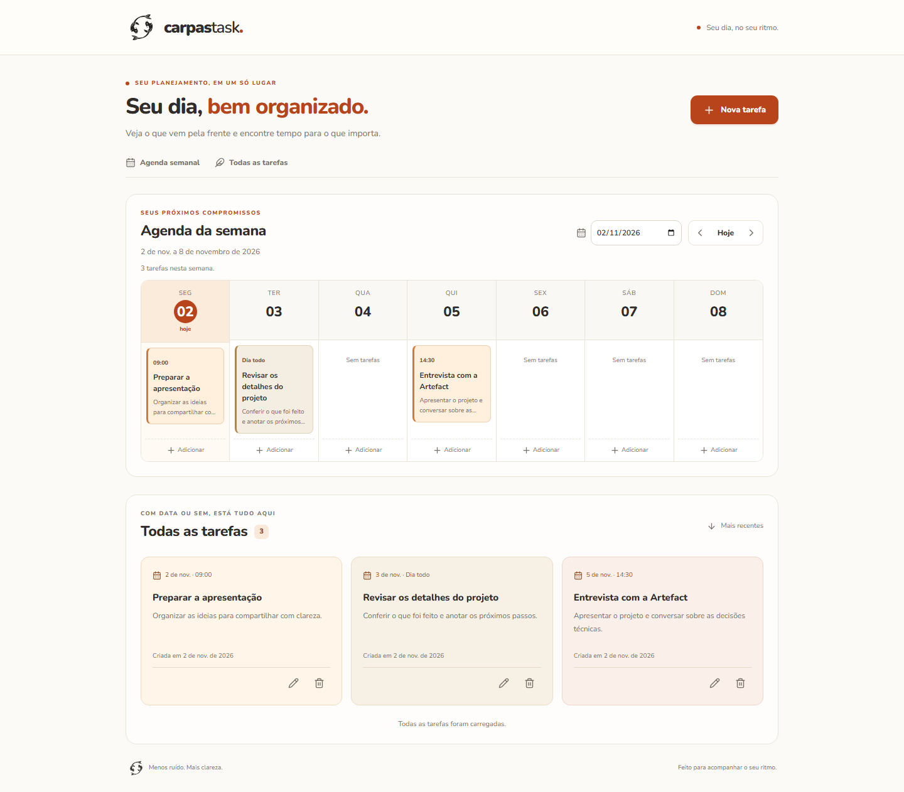
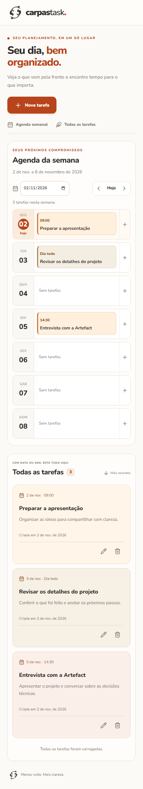
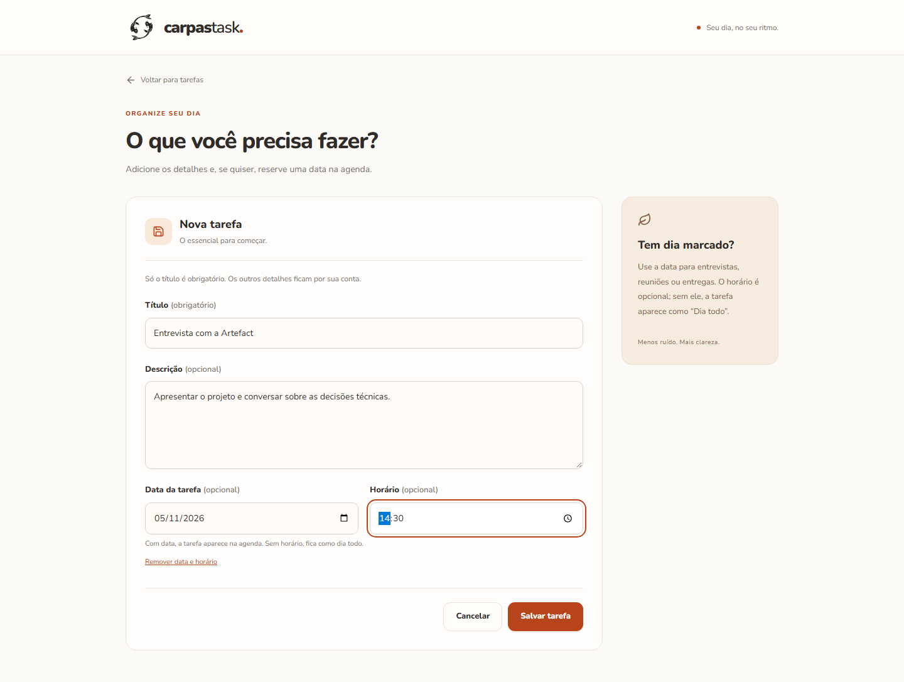

# CarpasTask

**Menos ruído. Mais clareza.** A small, accessible task manager built for the Artefact Software Engineer Brasil practical assessment.

Create, edit and delete tasks, optionally schedule a date/time, review a weekly agenda, and browse task cards with cursor pagination. The first task page and current weekly agenda are rendered on the server. The interface is Brazilian Portuguese, with a locally implemented two-koi SVG mark, responsive cards, dedicated create/edit pages and an accessible deletion dialog. There are no accounts, databases, external APIs or persistence services.

## Pages and assessment alignment

- `/`: dynamically server-rendered list, deletion confirmation and incremental loading.
- `/tarefas/nova`: dedicated task creation page.
- `/tarefas/[id]/editar`: dedicated edit page, loaded through a server-side tRPC caller. Refreshing or opening this address directly works; invalid/missing IDs display a localized not-found page.

The implementation follows the original assessment PDF. The interface uses Brazilian Portuguese; the PDF does not mandate English. Creation and editing use actual routes to match the PDF's wording “Página de Criação/Atualização” literally. The theory answers and public GitHub submission remain separate deliverables; no publication is automatic.

## Run locally

Prerequisites: Node.js 22 or newer and npm. Use one local Node.js process.

```sh
npm ci
npm run dev
```

Open http://127.0.0.1:3000. For a production-mode run:

```sh
npm run build
npm run start
```

The server binds to loopback by default. Stop it with Ctrl+C. Dependencies are pinned in `package.json`; commit `package-lock.json` with the source. `npm install` also works, while `npm ci` reproduces the lockfile.

## Verification

```sh
npm run typecheck
npm run lint
npm run test
npx playwright install chromium
npm run build
npm run test:e2e
```

The end-to-end runner starts and stops its own **production** Next.js server through the Node API, using the existing build. This avoids orphaned npm shell children on Windows. Leave port 3000 free. Backend tests create isolated repositories; browser tests clean the running repository before each test and run serially. No production reset endpoint is exposed. See [verification results](docs/verification.md) for actual execution results and limits.

## Stack and structure

Next.js **15** App Router, React 19, strict TypeScript, tRPC 11, Zod 4, TanStack Query 5, Tailwind CSS 3 and Lucide React. Vitest, React Testing Library and Playwright cover the practical behavior.

```text
src/
  app/                 App Router page, layout, loading/error UI, tRPC HTTP handler
  components/          Task workspace, form, native dialog, SVG logo
  lib/                 Shared contracts/validation and tRPC React provider
  server/
    api/               Typed tRPC router and context
    repositories/      In-memory task repository
tests/                 Router/repository and component tests
  e2e/                 Production browser and SSR verification
docs/                  Verification report and actual screenshots
```

The repository owns collection operations. The router owns input validation and not-found errors. React owns interaction state; TanStack Query owns server-state caching. A separate service layer would add indirection without additional business logic.

## Contract

```ts
type Task = {
  id: string; // server-generated UUID
  titulo: string; // trimmed, 1–120 characters
  descricao?: string; // trimmed, at most 2,000 characters
  dataCriacao: string; // server-generated ISO UTC timestamp
  dataAgendada?: string; // optional civil date, YYYY-MM-DD
  horario?: string; // optional HH:mm, requires a scheduled date
};
```

Blank descriptions normalize to `undefined`. Updates replace the editable fields and preserve ID and creation time. Creation timestamps display consistently in Brazilian Portuguese and UTC. Optional values are explicitly replaced on update so clearing a date/description works across JSON serialization. Shared Zod schemas provide immediate form validation and authoritative server validation. tRPC infers client types from the router; type imports do not send server code to the browser. `server-only` guards backend modules.

The original four required fields remain unchanged. Scheduling is an optional enhancement requested during interface refinement; the assessment permits at least those original fields. Dates are real calendar dates between 1900 and 9998, times use 24-hour `HH:mm`, and a time requires a date. These civil values do not shift across timezones. Creation timestamps remain distinct from scheduled dates. Leaving the date blank is valid; clearing it also clears the time. Tasks with a date but no time appear as **Dia todo**. No reminders or external calendar synchronization are implemented.

The HTTP adapter is `/api/trpc/[trpc]`; frontend calls use tRPC exclusively.

| Procedure     | Input                                             | Result                                |
| ------------- | ------------------------------------------------- | ------------------------------------- |
| `task.create` | `{ titulo, descricao? }`                          | Created task                          |
| `task.get`    | `{ id }`                                          | Task for the edit page                |
| `task.agenda` | `{ inicio, fim }` civil dates, bounded range      | All scheduled tasks in the date range |
| `task.list`   | `{ limit?: 1..50, cursor?: { dataCriacao, id } }` | `{ items, nextCursor }`               |
| `task.update` | `{ id, titulo, descricao? }`                      | Updated task                          |
| `task.delete` | `{ id }`                                          | `{ success: true }`                   |

Invalid inputs produce `BAD_REQUEST`. Missing records produce `NOT_FOUND` with “Tarefa não encontrada.” Unexpected failures have a generic user-facing message; response stack traces are removed. Forms preserve input on failure and disable controls while saving. Deletes wait for backend success. Successful mutations invalidate list queries and announce feedback; creation/editing return to the list with a localized success message. Query failures offer a retry.

## SSR and shared memory

`src/app/page.tsx` is a dynamic Node.js Server Component. It invokes the tRPC server caller directly, without HTTP to itself, and passes the first page into `useInfiniteQuery` through `initialData`. Next renders the client component's initial markup on the server. A 30-second stale window avoids a redundant request immediately after hydration. Query clients are created per provider, never shared between visitors.

The current weekly agenda is fetched alongside the first task page and hydrated into its own tRPC query. This query reads all scheduled tasks in that range, independently of card pagination; commitments are not omitted simply because their cards have not loaded yet. The current day uses `America/Fortaleza` on the server and is passed to the client to avoid hydration disagreements. The week begins on Monday. Week navigation and a native date picker fetch other ranges through tRPC; mutations invalidate both list and agenda queries.

There is no automatic root `loading.tsx` boundary: the server waits for the small in-memory reads before returning the page. This keeps initial task and agenda markup visible even with JavaScript disabled, rather than inside a streamed fragment that needs JavaScript to reveal it. Interactive queries and forms retain their loading feedback.

`src/server/repositories/tasks.ts` exports a controlled singleton repository, anchored on `globalThis` inside the Node.js process. This is intentional: Next may bundle route handlers and RSC into separate module graphs. Both obtain the same Map through the process global, including during development reloads. The production SSR test creates a task through HTTP tRPC, requests the page, checks an actual `<h3>` in the HTML, and opens it in a browser with JavaScript disabled. It therefore checks shared storage and rendered content together.

Data exists **only while that Node.js process is alive**. Restarting loses everything. Independent processes, clusters, containers and serverless instances do not share this memory. Hosting is not required or configured. A database would contradict the assessment. The app is intended for a single local user/process; it has no cross-browser live subscription.

## Infinite scrolling

The initial page contains ten tasks. The repository sorts by descending ISO creation date, then descending UUID. Cursors carry both values rather than a row index or offset. The next page selects tuples strictly after the boundary, even when the cursor's record has been deleted. Later insertions appear on refresh/invalidation; older pages remain ordered. Tests cover timestamp ties, deletion of a cursor record, insertion between page loads and traversal of more than two pages.

IntersectionObserver preloads within 160px of the list end. Fetches are blocked while a query is fetching. A keyboard-accessible **Carregar mais** button is always available while more results exist, and the rendered task collection deduplicates by ID. Successful mutations invalidate the loaded pages; TanStack Query refetches from the start to rebuild cursor boundaries. The final page displays an end-of-list message.

## Design, accessibility and security

The interface uses burnt orange, cream surfaces, rounded cards and the self-hosted Nunito variable font (`@fontsource-variable/nunito`, SIL Open Font License). There are no requests to Google Fonts at runtime. A custom monochrome SVG shows two koi circling, inspired by the user-provided reference; no stock image is embedded. A compact planning header, seven-day agenda and responsive card grid prioritize task content. Week columns become day rows on phones, with no page-level horizontal scrolling. Warm card tints provide visual rhythm without adding priority/status fields or unrelated dashboard features.

Semantic headings, labeled fields, visible focus rings, a skip link and status/alert regions support keyboard and screen-reader use. Native `<dialog>.showModal()` provides focus containment for deletion; Escape cancels, and closing restores focus. Pending deletion prevents dismissal. Creation/editing use separate pages with a back link, cancel and save actions. Long content wraps and mobile actions stay visible. Motion respects reduced-motion preferences.

React escapes user text; there is no unsafe HTML rendering. Server-side schemas enforce lengths and UUIDs. No secrets or environment variables are needed. `.gitignore` excludes environment files, builds, dependencies and generated test artifacts. The public repository must not include `node_modules` or `.next`. This assessment is a local application: authentication, authorization, rate limiting and durable/multi-instance storage are outside scope. Do not expose an unauthenticated task store as a shared production service.

## Acceptance checklist

| Requirement                                  | Implementation                                       | Verification                                                     |
| -------------------------------------------- | ---------------------------------------------------- | ---------------------------------------------------------------- |
| Next.js 15 / strict TypeScript / lockfile    | `package.json`, `tsconfig.json`, `package-lock.json` | Installed version, typecheck, production build                   |
| Typed tRPC + TanStack Query                  | `server/api/router.ts`, `lib/trpc.tsx`, HTTP route   | Router tests and browser CRUD                                    |
| Exact Portuguese data fields                 | `lib/task.ts`                                        | Router tests                                                     |
| Server UUID/date and normalized fields       | Repository and shared Zod schema                     | Create/update/validation tests                                   |
| Server-only, shared in-memory storage        | Process singleton Map                                | HTTP creation + independent production SSR request               |
| Create/list/update/delete                    | Router and workspace                                 | Router tests and production browser flow                         |
| Title, description and ID validation         | `lib/task.ts`                                        | Invalid/blank/overlong input tests                               |
| Meaningful missing-task errors               | Router                                               | Missing update/delete tests                                      |
| Genuine dynamic SSR and hydration            | `app/page.tsx`, query initial data                   | HTML heading assertion and JavaScript-disabled browser           |
| Form hooks, loading and duplicate protection | `task-form.tsx`, mutations                           | Component tests and browser flow                                 |
| Success/error/empty feedback                 | Workspace, form, route error UI                      | Components and browser tests                                     |
| Confirm/cancel deletion                      | Native dialog and workspace                          | Browser confirmation/cancel/CRUD test                            |
| Infinite scroll + accessible fallback        | Observer, query and tuple cursor                     | Router pagination, production 25-task browser test               |
| Stable ordering with concurrent changes      | Repository comparator/cursor                         | Tie, insert and deleted-boundary test                            |
| Responsive long content                      | `app/globals.css`                                    | 390px browser overflow checks/screenshots                        |
| Branding/local SVG / Portuguese UI           | Two-koi logo, metadata, self-hosted font, workspace  | Source, font-load assertion and screenshots                      |
| Dedicated creation/update pages              | `app/tarefas/nova`, `app/tarefas/[id]/editar`        | Direct URL, refresh, cancel, submit and missing-ID browser tests |
| Keyboard dialog and focus restoration        | `dialog.tsx`                                         | Escape/focus browser assertions                                  |
| Production flow / clean browser errors       | Playwright config                                    | Production end-to-end suite                                      |
| Documentation and limitations                | This README and verification report                  | Final review                                                     |
| No secrets or publishing                     | `.gitignore`, source review                          | Credential scan; no remote configured                            |

The original assessment PDF's practical requirements were reviewed against the implementation. No theoretical answer sheet or submission PDF is generated.

Suggested public repository name: **carpastask**. No repository is published automatically.

## Actual interface

These captures show the real application with fictitious sample tasks, including an interview with a date/time. A normal server start remains empty; no personal data or permanent demo records are included.






